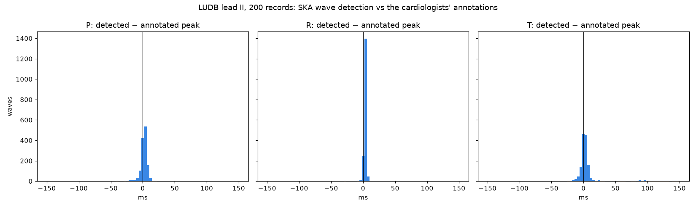
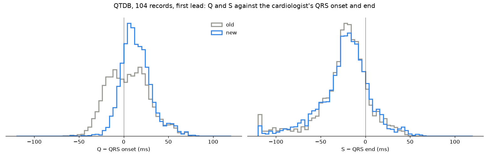

# SKA ECG Detection Validation

The SKA ECG learner reads one step per wave, P → Q → R → S → T. The waves are found in the raw
ECG by [`complex-events/ska_complex_events.py`](https://github.com/quantiota/SKA-ECG-Heart-Rate-Variability/tree/main/complex-events)
of [SKA-ECG-Heart-Rate-Variability](https://github.com/quantiota/SKA-ECG-Heart-Rate-Variability).
This repository checks that detection against waves marked by cardiologists.

## Q and S: old rule and new rule

**Old rule** (`ska_complex_events.py`): Q = the lowest point in [R − 60, R] ms, S = the lowest point
in [R, R + 60] ms. When the foot of R is closer to R than the PR segment is low, Q falls at the
60 ms edge of the window, in the PR segment.

**New rule** (`detect_qs.py`, applied in memory, `ska_complex_events.py` unchanged): walking from R,
on the same baseline-removed signal, at most 120 ms:

- **Q**: the first minimum walking back, the foot of the R upstroke.
- **S**: the first minimum below the baseline walking forward, else the first minimum.
- A minimum ends when the signal rises from it for at least 3 ms or by more than 0.005 mV.
- The search starts once the walk is below half of the R height (a notch on the top of R is not a Q
  or an S); if the walk never goes below half of R, the old position is kept.

P, R and T are the same in both rules.

## Data

[LUDB](https://physionet.org/content/ludb/1.0.1/), the Lobachevsky University Electrocardiography
Database (PhysioNet): 200 records, 10 s, 500 Hz, 12 leads. For each wave the cardiologists marked
its onset, peak and end (P, QRS, T). Lead II is used, as in the SKA ECG repositories.

[QTDB](https://physionet.org/content/qtdb/1.0.0/), the QT Database (PhysioNet): 105 records, 15 min,
250 Hz, 2 leads. The `.q1c` files hold the first cardiologist's marks on selected beats: QRS onset,
QRS peak, QRS end. The first lead is used; 104 records have marked QRS (3,528 QRS).

## Method

For every annotated wave, the detected wave of the same kind nearest to it (within 150 ms) is compared:

- **P, R, T**: error = detected peak − annotated peak.
- **Q**: is it inside [QRS onset, R peak]?
- **S**: is it inside [R peak, QRS end]?
- **False detection**: inside the annotated span of a record, a detected P, R or T with no annotated wave of the same kind within 150 ms.

## LUDB

| wave | annotated | matched | median error | within 20 ms | inside the annotated wave | false detections |
|---|---|---|---|---|---|---|
| P | 1,401 | 96.5 % | 2 ms | 97.2 % | 99.0 % | 3 / 1,355 * |
| R | 1,817 | 95.0 % | 2 ms | 99.0 % | — | 5 / 1,729 * |
| T | 1,642 | 90.1 % | 4 ms | 90.7 % | 94.2 % | 86 / 1,565 |
| Q, old rule | 1,726 QRS | — | — | — | 82.1 % | — |
| Q, new rule | 1,726 QRS | — | — | — | 99.2 % | — |
| S, old rule | 1,726 QRS | — | — | — | 81.1 % | — |
| S, new rule | 1,726 QRS | — | — | — | 93.2 % | — |

\* In records where the wave is annotated. In 23 records no P is annotated (atrial fibrillation,
atrial flutter): there the detector still reports a P in each cycle (204). In one record no QRS
is annotated (9 R).



## QTDB

For every marked QRS, the detected beat whose R is nearest (within 150 ms) is compared.
Q is inside if it lies in [QRS onset, R]; S, in [R, QRS end].

| | old rule | new rule |
|---|---|---|
| QRS matched | 98.2 % | 98.2 % |
| Q inside the QRS | 56.3 % | 80.7 % |
| Q − QRS onset, median | 4 ms | 12 ms |
| S inside the QRS | 88.6 % | 87.1 % |
| S − QRS end, median | −24 ms | −24 ms |



**Missed QRS**: 63 of 3,528 (1.8 %). All 63 have a QRS energy below the R threshold of the detector
(40 % of the maximum of their 5-s window):

| record | lead | missed | |
|---|---|---|---|
| sel104 | V5 | 39 | paced rhythm |
| sel114 | V5 | 12 | one large beat raises the window maximum (4.8 × the median beat) |
| sele0111 | D3 | 6 | |
| sel35, sel37, sele0124, sele0129, sele0133, sele0704 | | 1 each | |

## NeuroKit2

The same QTDB check with [NeuroKit2](https://github.com/neuropsychology/NeuroKit) 0.2.13
(`ecg_clean` → `ecg_peaks` → `ecg_delineate`):

| | new rule | NeuroKit2 |
|---|---|---|
| QRS matched | 98.2 % | 99.5 % |
| Q inside the QRS | 80.7 % | 35.2 % |
| Q − QRS onset, median | 12 ms | −20 ms |
| S inside the QRS | 87.1 % | 64.9 % |
| S − QRS end, median | −24 ms | −12 ms |

The `peak` and `dwt` methods of `ecg_delineate` give the same Q and S: its source states "No dwt
defined method for Q and S peak" and "Adopting manual method from "peak" method" (the same holds
for `cwt`). On the 38 healthy women of SKA-ECG-Heart-Rate-Variability (700 cycles each), NeuroKit2 and
the SKA detector agree on P, R and T: median difference 1, −1 and 0 ms; within 20 ms in 99.9 %,
100 % and 100 % of the cycles (median over the 38 women).

## Files

- `validate_detection.py`: the LUDB validation (`--rule new` for the new rule)
- `detect_qs.py`: the new Q and S rule
- `qtdb_check.py`: Q and S on QTDB, old and new rule
- `qtdb_missed.py`: the missed QRS against the R threshold
- `results/ludb_detection.csv`, `results/ludb_detection_new.csv`: one row per annotated wave
- `results/ludb_summary.csv`, `results/ludb_summary_new.csv`: the LUDB table
- `results/qtdb_qs.csv`: one row per marked QRS and rule; `results/qtdb_summary.csv`: the QTDB table
- `results/qtdb_missed.csv`: the missed QRS
- `figures/ludb_detection_errors.png`, `figures/ludb_detection_errors_new.png`, `figures/qtdb_qs.png`
- `logs/`

## Run

```bash
git clone https://github.com/quantiota/SKA-ECG-Heart-Rate-Variability.git
git clone https://github.com/quantiota/SKA-ECG-Detection-Validation.git
cd SKA-ECG-Detection-Validation
pip install numpy pandas scipy matplotlib

# LUDB, lead II only: .hea, .dat and the .ii annotations of the 200 records
mkdir -p data && cd data
B=https://physionet.org/files/ludb/1.0.1
wget -q $B/RECORDS $B/SHA256SUMS.txt
for r in $(sed 's#data/##' RECORDS); do for e in hea dat ii; do wget -q -c $B/data/$r.$e; done; done
# check every file against PhysioNet's checksums: prints only the files that fail (download them again)
grep -E 'data/[0-9]+\.(hea|dat|ii)$' SHA256SUMS.txt | sed 's# data/# #' | sha256sum -c --quiet -
cd ..

# QTDB: .hea, .dat and the .q1c marks of the 105 records
mkdir -p data/qtdb && cd data/qtdb
B=https://physionet-open.s3.amazonaws.com/qtdb/1.0.0
wget -q $B/RECORDS $B/SHA256SUMS.txt
for r in $(cat RECORDS); do for e in hea dat q1c; do wget -q -c $B/$r.$e; done; done
grep -E '\.(hea|dat|q1c)$' SHA256SUMS.txt | sha256sum -c --quiet -
cd ../..

python validate_detection.py
python validate_detection.py --rule new
python qtdb_check.py
python qtdb_missed.py
```

## Reference

A. I. Kalyakulina et al., "LUDB: A New Open-Access Validation Tool for Electrocardiogram
Delineation Algorithms," IEEE Access, vol. 8, pp. 186181–186190, 2020,
doi: [10.1109/ACCESS.2020.3029211](https://doi.org/10.1109/ACCESS.2020.3029211).
Data: PhysioNet, ODC Attribution License.

P. Laguna, R. G. Mark, A. L. Goldberger, G. B. Moody, "A Database for Evaluation of Algorithms for
Measurement of QT and Other Waveform Intervals in the ECG," Computers in Cardiology, vol. 24,
pp. 673–676, 1997. Data: PhysioNet, ODC Attribution License.

## License

MIT
